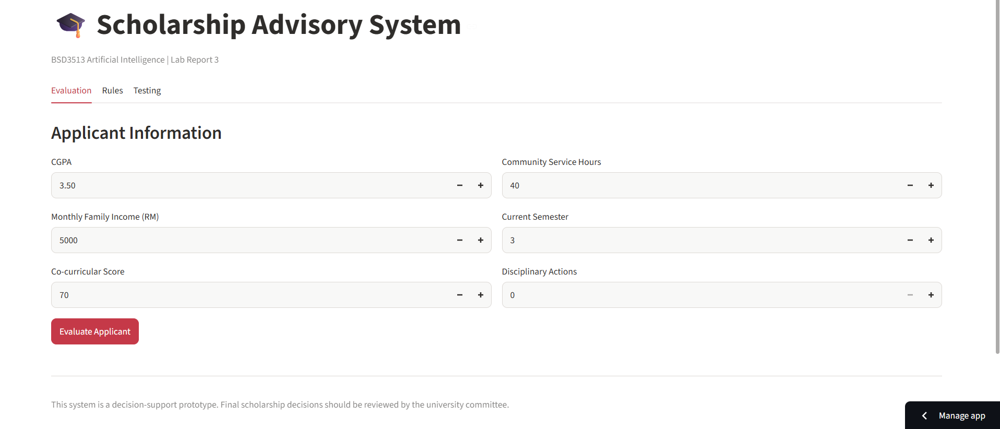
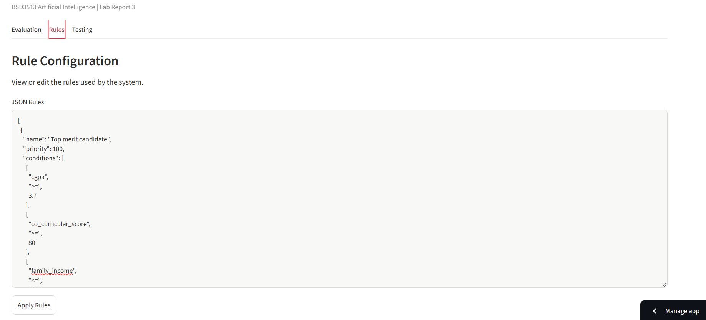

# Scholarship Advisory System
### BSD3513 – Introduction to Artificial Intelligence | Lab Report 3

## 1. Project Overview

This project develops a **Scholarship Advisory System** using a Python-based Rule-Based System. The application assists a university scholarship committee in evaluating scholarship applicants based on their academic performance, financial background, co-curricular involvement and disciplinary records.

The system uses predefined IF–THEN rules to evaluate applicant information and generate scholarship recommendations.

- **Live Application:** [(https://lab-report-3-46ay4a5zpdpan84hx44exu.streamlit.app/)]
- **GitHub Repository:** [(https://github.com/chanwanwen/LAB-REPORT-3)]

## 2. Objectives

- Understand knowledge representation using rule-based systems.
- Implement an inference engine using Python.
- Evaluate scholarship applicants using predefined conditions.
- Support editable JSON rules and priority-based decisions.
- Develop and deploy an interactive web application using Streamlit.

## 3. Technologies Used

- Python
- Streamlit
- Pandas
- JSON
- GitHub

## 4. System Features

- **Applicant Information:** Enter CGPA, monthly family income, co-curricular score, community service hours, current semester and disciplinary actions.
- **Rule-Based Engine:** Evaluate applicant information using IF–THEN conditions.
- **Priority-Based Decisions:** Select the matching rule with the highest priority.
- **JSON Rule Editor:** View, modify and restore scholarship rules.
- **Evaluation Results:** Display scholarship decisions, reasons and matched rules.
- **System Testing:** Test different applicant scenarios.

## 5. Scholarship Decisions

| Decision | Description |
|---|---|
| AWARD_FULL | Full scholarship recommendation |
| AWARD_PARTIAL | Partial scholarship recommendation |
| REVIEW | Requires further assessment |
| REJECT | Not eligible under the matching rule |

## 6. Project Structure

```text
SD24059_Lab3/
│
├── SD24059_Lab3.py
├── requirements.txt
└── README.md
```

## 7. Installation and Setup

**Step 1: Clone the repository**

```bash
git clone YOUR_GITHUB_REPOSITORY_URL
```

**Step 2: Navigate to the project folder**

```bash
cd SD24059_Lab3
```

**Step 3: Install dependencies**

```bash
pip install -r requirements.txt
```

**Step 4: Run the application**

```bash
streamlit run SD24059_Lab3.py
```

## 8. Project Documentation

1. Main Application Interface


The main interface provides three sections: Evaluation, Rules and Testing.

2. Applicant Information


Users can enter applicant details, including CGPA, family income, co-curricular score, community service hours, semester and disciplinary actions.

3. Scholarship Evaluation


The system evaluates applicant information and generates a scholarship recommendation based on the predefined rules.

4. JSON Rule Configuration


The JSON editor allows users to view and modify the scholarship rules, including conditions, priorities and actions.

5. Rule Matching


The inference engine checks all conditions and selects the matching rule with the highest priority.

6. System Testing


Different applicant scenarios are tested to verify the system's decision-making functionality.
